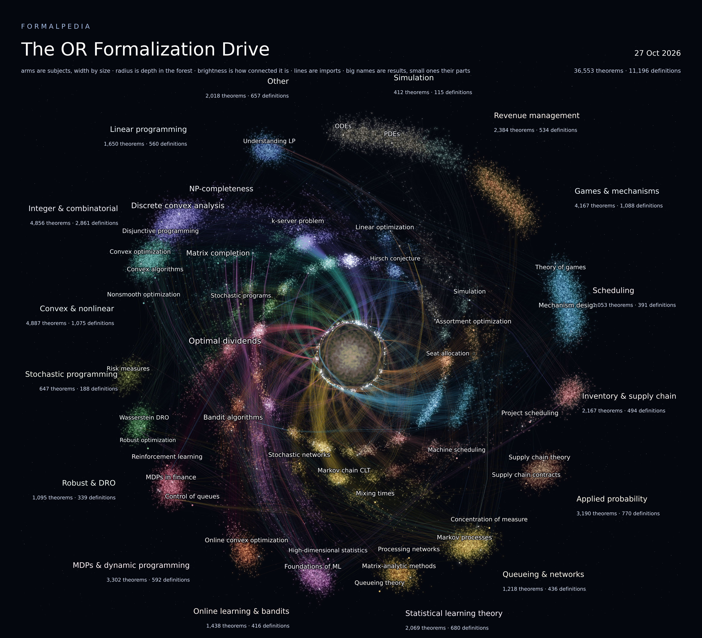

# The OR Formalization Drive

Every theorem, definition, and accepted solution from
[Formalpedia](https://github.com/prove2me/formalpedia) that belongs to the
[Prove2Me](https://prove2.me) collection **The OR Formalization Drive**
(`the-or-formalization-drive`), together with everything those items import.
The subset is self-contained: every local import resolves inside this
repository.

Snapshot generated 2026-10-27 17:07 UTC.

## License

Everything in this repository is licensed under [Apache 2.0](LICENSE). Every
Lean file's header names its author and links to the original theorem or
submission on Prove2Me, and `index-*.jsonl` records the same.

## What is included

1. **Seeds**: for each of the collection's 4,288 missions, its goal theorem,
   every theorem recorded as a mission member, and every milestone's theorem
   (45,189 ids in total; see `seeds.json`).
2. **Closure**: everything the seeds import, transitively, in their statement
   preambles or their solutions. Only downward: results elsewhere that use
   these are not included.

42,418 seeds are in this snapshot. The other 2,771 (`missing_seeds.txt`) are
not in the Formalpedia snapshot this subset was taken from. 5,331 items are included only because a seed imports them.

## Environments

| Directory | Mathlib | Toolchain | Theorems | Definitions | Solutions | Edges |
|---|---|---|---|---|---|---|
| `envs/0df444a` | `0df444a360ea` | leanprover/lean4:v4.33.1 | 34,801 | 10,988 | 22,264 | 77,202 |
| `envs/c5ea003` | `c5ea00351c28` | leanprover/lean4:v4.30.0 | 1,746 | 205 | 1,824 | 5,023 |
| `envs/777aaa6` | `777aaa61dcd2` | leanprover/lean4:v4.29.0-rc3 | 6 | 3 | 6 | 15 |

## Layout

Same as Formalpedia:

- `envs/<env>/Theorems/Thm_<slug>.lean`: the preamble and the statement, with
  proof `sorry`.
- `envs/<env>/Definitions/Def_<slug>.lean`: definitions.
- `envs/<env>/Solutions/Sol_<slug>.lean`: accepted proofs, verbatim as
  verified, under a provenance header (`_2`, `_3`, ... for further proofs).
- `envs/<env>/index-*.jsonl`: one JSON line per theorem.
- `envs/<env>/graph-*.jsonl`: import edges (`parent` imports `child`).
- `MANIFEST.json`: counts per environment, plus a `subset` section describing
  how this subset was selected.
- `paths.txt`: every Lean file in the subset.
